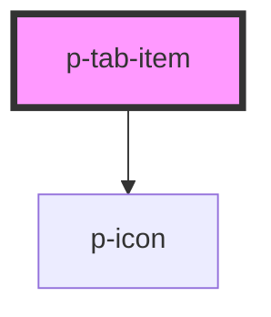

# p-tab-item

<!-- Auto Generated Below -->

## Properties

| Property          | Attribute          | Description                     | Type                        | Default |
| ----------------- | ------------------ | ------------------------------- | --------------------------- | ------- |
| `active`          | `active`           | Wether the tab item is active   | `boolean`                   | `false` |
| `chevron`         | `chevron`          | Wether to show a chevron or not | `"down" \| "up" \| boolean` | `false` |
| `chevronPosition` | `chevron-position` | Chevron position                | `"end" \| "start"`          | `'end'` |

## Dependencies

### Depends on

- [p-icon](../../icon)

### Graph

----------------------------------------------

*Built with [StencilJS](https://stenciljs.com/)*
